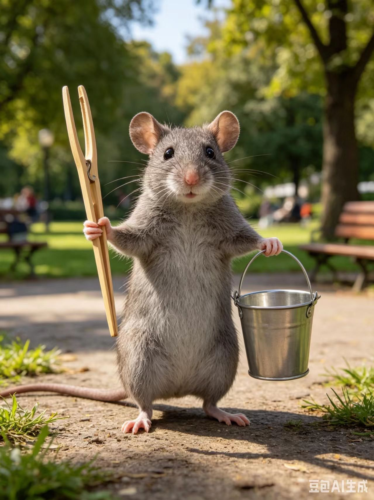
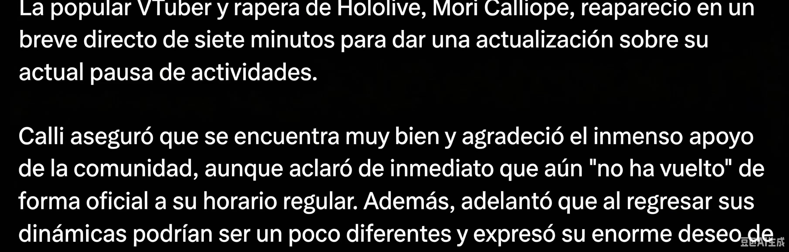
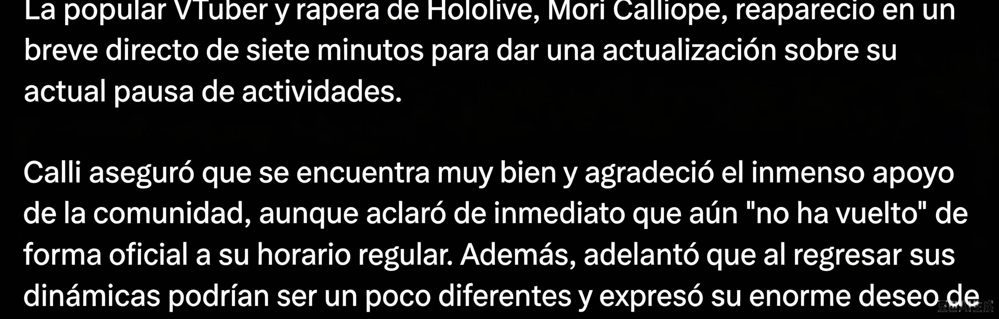

# 豆包水印去除工具（Python + LaMa）

基于深度学习模型 **LaMa（Large Mask Inpainting）** 的豆包 AI 生图水印去除工具。
专门针对豆包水印的特征做了多阶段定位 + 极性自适应 mask 提取, Apple Silicon 上
MPS 加速, 单图 ~3-7s。

> 工具定位: **豆包水印专用**, 不是通用水印去除器。其他水印 (Midjourney/SD 等) 不在能力范围内, 见下文"已知不足"。

---

## 效果对比

### 样例 1: 浅色背景照片 (photo 模式)

| 原图 | 去除后 |
|---|---|
|  |  |

右下角"豆包AI生成"水印被 LaMa 重画, 草地纹理无明显接缝。

### 样例 2: 深色背景文档 (document 模式)

| 原图 | 去除后 |
|---|---|
|  |  |

黑底白字场景下水印干净去除, 西语正文一字未动。
这是工具早期版本完全失效的场景, 经"locator 全局极性检测 + mask 极性自适应"修复后能稳定处理。

---

## 技术栈

| 组件 | 用途 |
|---|---|
| **LaMa** (Resolution-robust Large Mask Inpainting, WACV 2022) | 神经网络 inpainting, 在 mask 区域生成符合周围语境的内容 |
| **PyTorch** (`simple-lama-inpainting`) | LaMa 推理后端, 支持 MPS / CUDA / CPU 自动选择 |
| **OpenCV** (`opencv-python-headless`) | 多尺度模板匹配定位水印 + 灰度/形态学 mask 提取 |
| **NumPy** | 像素级 mask 运算 |
| **Pillow** | PIL ↔ ndarray 转换 (LaMa API 要求) |
| Python **3.10 - 3.13** | (3.14 暂不支持, simple-lama-inpainting 依赖未跟进) |

### 算法 pipeline

```
原图 ──► [1] 模板匹配定位 ──► [2] mask 提取 ──► [3] (可选) alpha 反解 ──► [4] LaMa 修复 ──► 输出
            └ locator.py         └ mask_extractor.py    └ alpha_unblend.py       └ inpainter.py
```

1. **定位**: 多尺度模板匹配 (`cv2.matchTemplate`, TM_CCOEFF_NORMED), 在图的右下角搜索水印。失败时回退到经验 bbox (右下相对位置)。
   全局极性检测: 整图平均亮度 < 100 视为黑底白字场景, 搜索图反相后再匹配, 解决极性反向导致分数压低的问题。
2. **mask 提取**: 在 bbox 内通过亮度窗口 (200-230) + RGB 灰度判定锁定水印候选像素;
   暗背景下自动翻转 (80-180 + 保护"亮于阈值"的白字), 避免 0 px mask。
3. **alpha 反解** (可选): 对水印叠在保护区上的像素做数学反解 `I_orig = (I_obs - α·logo) / (1-α)`, 理论上能保留更多字母细节。实验性功能。
4. **LaMa 修复**: 把 mask 区域送 LaMa 模型生成。MPS 设备上 2048px 单图 ~5s, CPU ~280s。

### 性能

2048×2048 单图, Apple Silicon (M 系列):

| Device | 单图耗时 |
|---|---|
| MPS | ~5s |
| CPU | ~280s |

设备优先级自动选择: MPS > CUDA > CPU。

---

## 已知不足

实测三类典型场景, 工具能力边界清楚:

| 场景 | 现状 | 原因 |
|---|---|---|
| 豆包水印 + 浅背景 | ✅ 干净去除 | locator 兜底 bbox 命中, mask 识别准 |
| 豆包水印 + 深背景 (黑底白字) | ✅ 干净去除 (新版) | 极性自适应改进后可用; 早期版本完全失效 |
| **非豆包水印** (Midjourney/SD/其他) | ❌ 几乎不动 | locator 模板单一, mask 颜色阈值豆包专属 |

具体不足:

1. **模板单一**: 当前 `assets/watermark_template.png` 从一张 2048×2048 文档图提取, 对豆包水印的尺寸/字体/颜色变体泛化未充分测试。新版豆包水印可能匹配不上。
2. **模板匹配分数普遍偏低**: 实测豆包水印的 `TM_CCOEFF_NORMED` 分数普遍只到 0.3-0.4, 不到 `MIN_MATCH_SCORE = 0.5` 阈值, **大多数情况依赖 fallback bbox** (右下角经验位置)。这意味着工具对"水印不在右下角"的图基本失效。
3. **document 模式残留**: 水印叠在字母上的部分无法完美区分"是字母还是水印", 保护策略会保留这些像素, 肉眼能看到淡淡水印痕迹。
4. **photo 模式重画**: bbox 内的所有内容都会被 LaMa 重新生成, 对文档场景会让字母走样。
5. **依赖 `Pillow<10`**: 被 `simple-lama-inpainting` 锁定。
6. **CPU 极慢**: 没有 GPU/MPS 时 2048px 单图近 5 分钟, 实际只能在 Mac M 系列或 NVIDIA GPU 上跑。

### 不打算修的事

- 通用水印去除 — 项目定位是豆包专用, 通用场景建议用 [IOPaint](https://github.com/Sanster/IOPaint)。
- 跨多个 AI 服务的水印 — 同上。

---

## 部署方式

当前的主要分发形态:

### 1. 本地 CLI (现状, 推荐给开发者)

```bash
git clone <repo>
cd doubao_watermark_tool
python3.12 -m venv .venv   # 需要 Python 3.10-3.13
source .venv/bin/activate
pip install -r requirements.txt
pip install -e .
```

首次运行会下载 LaMa 权重 (~200 MB) 到 `~/.cache/torch/hub/checkpoints/`。

### 2. 其他候选 (尚未实现)

| 方式 | 适合谁 | 工作量 |
|---|---|---|
| **PyPI 发布** (`pip install doubao-remover`) | 会 Python 的用户 | 低 |
| **Hugging Face Spaces** (浏览器拖图上传) | 任何人, 不用配环境 | 中 (写 Gradio UI) |
| **Docker image** (`docker run`) | 有 Docker 的开发者 | 低-中 |
| **Vercel / Web UI** | 公开 Demo 场景 | 中-高 (推理需放 GPU 后端, Vercel 仅作前端) |
| **PyInstaller 单文件可执行** | Windows/Mac 普通用户 | 中-高 (torch 体积大, 跨平台 CI 复杂) |

### Vercel 部署的特殊说明

Vercel Serverless Functions 的 250MB 包体积上限、CPU only、300s 超时几个硬约束, 让"把整个 CLI 直接部署成 Function"不可行 (PyTorch 单个就 ~200MB)。可行路径只有:

- **前端在 Vercel, 推理走外部 GPU 服务** (Modal / Replicate / HF Inference Endpoints)
- **Vercel Sandbox** (Firecracker microVM, 限制更宽松, 但仍 CPU only)

更详细的部署评估见后续 docs/。

---

## 用法

### 单图

```bash
# 默认 document 模式 (保护文档黑字)
python -m doubao_remover -i input.jpg

# 指定输出路径
python -m doubao_remover -i input.jpg -o output.jpg

# photo 模式: 水印彻底消除, 但 bbox 内细节会被 LaMa 重画
python -m doubao_remover -i input.jpg --mode photo

# alpha 反解 (实验性)
python -m doubao_remover -i input.jpg --alpha-unblend

# 详细日志
python -m doubao_remover -i input.jpg -v
```

未指定 `-o` 时输出到 `<input>_clean.<ext>`, **不会覆盖原文件** (除非显式加 `--overwrite`)。

### 批量

```bash
python -m doubao_remover -i input_dir/ -o output_dir/
```

### 模式选择

| 模式 | 目标 | 代价 | 适用 |
|---|---|---|---|
| `document` (默认) | 保护文档黑字 / 暗部细节 | 水印叠在字母上的部分有残留 | 截图、文档、表格、PPT、白底黑字图 |
| `photo` | 彻底消除水印 | bbox 内细节会被 LaMa 重画 | 照片、插画、纹理背景、不在乎右下角细节是否一致的图 |

### `--alpha-unblend` (实验性)

对水印叠在保护区上的像素做数学反解。理论上能保留更多字母细节, 但**实测在文档场景反而把字母 anti-alias 压暗**, 仅在你能接受字母略微变暗 / 看效果时启用。

---

## 目录结构

```
.
├── pyproject.toml
├── requirements.txt
├── assets/
│   └── watermark_shape_mask.png   形状二值模板
├── docs/
│   └── comparison/                效果对比样例图 (见 README 上方)
├── scripts/
│   └── build_template.py          一次性模板提取脚本
├── src/doubao_remover/
│   ├── __main__.py                CLI 入口
│   ├── locator.py                 多尺度模板匹配 + 极性检测 + 经验 bbox 兜底
│   ├── mask_extractor.py          掩码提取 (document/photo 双模式 + 极性自适应)
│   ├── alpha_unblend.py           Alpha 反向解混合
│   ├── inpainter.py               LaMa 封装 (含 MPS 加速)
│   ├── pipeline.py                端到端串联
│   └── assets/
│       └── watermark_template.png  随包分发的默认水印模板
└── tests/                          pytest 用例
```
